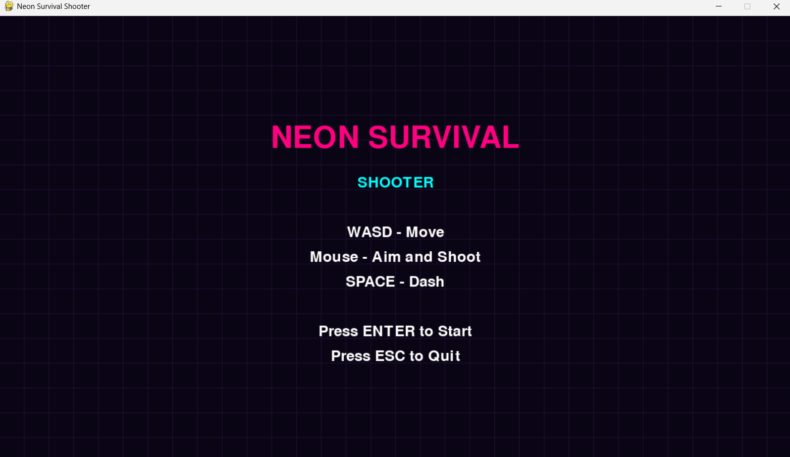
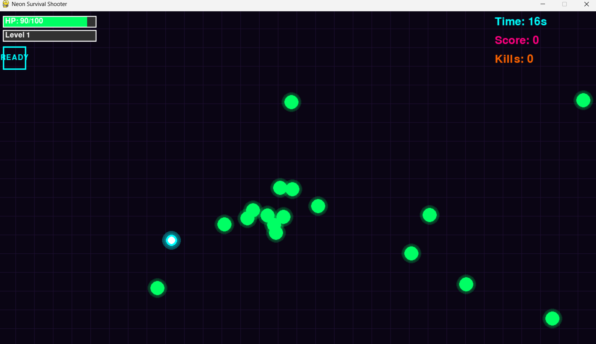

# Neon Cyberpunk Survival Shooter

A 2D cyberpunk-themed survival shooter game developed using Python and Pygame CE.

## About the Project

Neon Cyberpunk Survival Shooter is a Python-based 2D survival shooter game featuring a cyberpunk-inspired theme.

The project uses Pygame CE for game development and rendering.

## Technologies Used

- Python
- Pygame CE

## Project Structure

```text
neon-cyberpunk-survival-shooter/
│
├── main.py
├── requirements.txt
└── README.md
```

## Installation and Setup

**1. Clone the repository**

```bash
git clone YOUR_GITHUB_REPOSITORY_URL
```

**2. Navigate to the project directory**

```bash
cd neon-cyberpunk-survival-shooter
```

**3. Install dependencies**

```bash
pip install -r requirements.txt
```

**4. Run the game**

```bash
python main.py
```

## Future Improvements

- Additional gameplay features
- Improved enemy mechanics
- Enhanced visual effects
- Additional levels and challenges

## Author

Tarun R
---

## Screenshots

### Main Menu


### Gameplay

